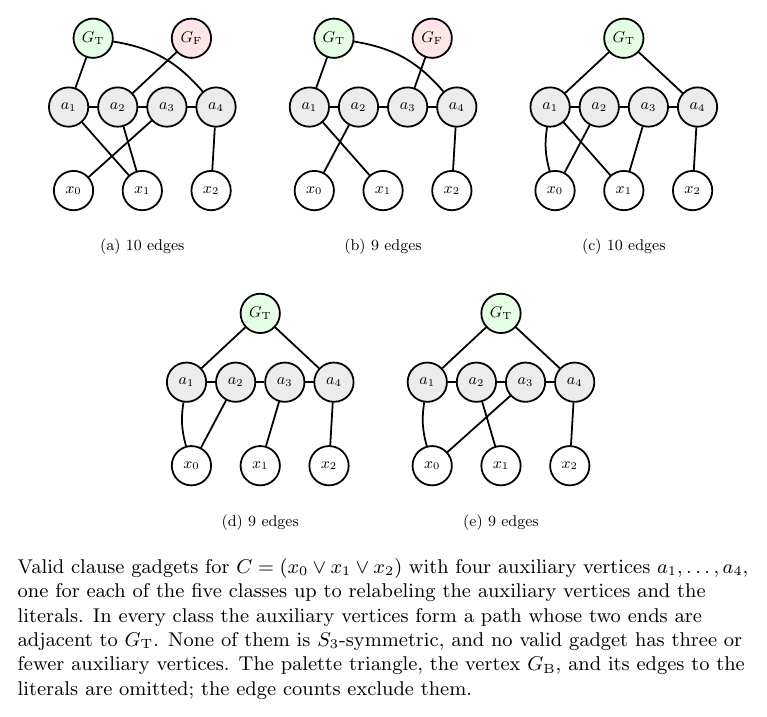

# Asymmetric clause gadgets with four auxiliary vertices

Without the S3 symmetry of the paper, a valid clause gadget can be smaller
than the trident. This folder shows the smallest ones and a short program
that checks them.



The figure (`four-auxiliary-gadgets.pdf`, source `four-auxiliary-gadgets.tex`)
shows one gadget for each of the five classes up to relabeling the auxiliary
vertices and the literals. Validity is that of the root README: with the
anchors colored T, F, B, a proper 3-coloring exists for exactly the
satisfying inputs. All eight inputs are checked, since the gadgets are not
symmetric.

- No valid gadget has three or fewer auxiliary vertices.
- With four auxiliary vertices there are 30 valid gadgets up to relabeling
  the auxiliary vertices. They fall into the five classes of the figure, six
  in each, so none of them is S3-symmetric.
- In every class the auxiliary vertices form a path whose two ends are
  adjacent to G_T.

For comparison, the OR-chain of Fig. 1(c) of the paper uses five auxiliary
vertices, and the trident and the Kleinberg-Tardos gadget use six.

## Check

```bash
cc -O2 -o check_small_gadgets check_small_gadgets.c
./check_small_gadgets
```

For k = 0, ..., 4 auxiliary vertices, the program tries every set of edges
with an auxiliary endpoint, binom(k,2) + 6k pairs (the comment at the top of
the file explains why no other pair can be an edge of a valid gadget), on all
eight inputs. It prints the number of valid gadgets and their classes. Then
it checks the five gadgets of the figure: each is valid, and they lie in the
five different classes. Its output is in `check_small_gadgets.log` (Apple M1
Max, about three seconds).

## Provenance

The gadgets were first found by the authors' original enumeration program
(see the root README). `check_small_gadgets.c` was written by Claude
(Anthropic) as an independent check; it shares no code with that program or
with `Sweep.lean`.
